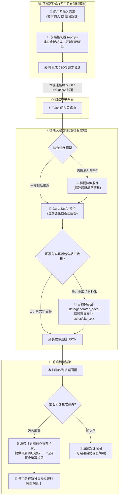
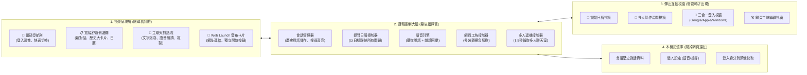
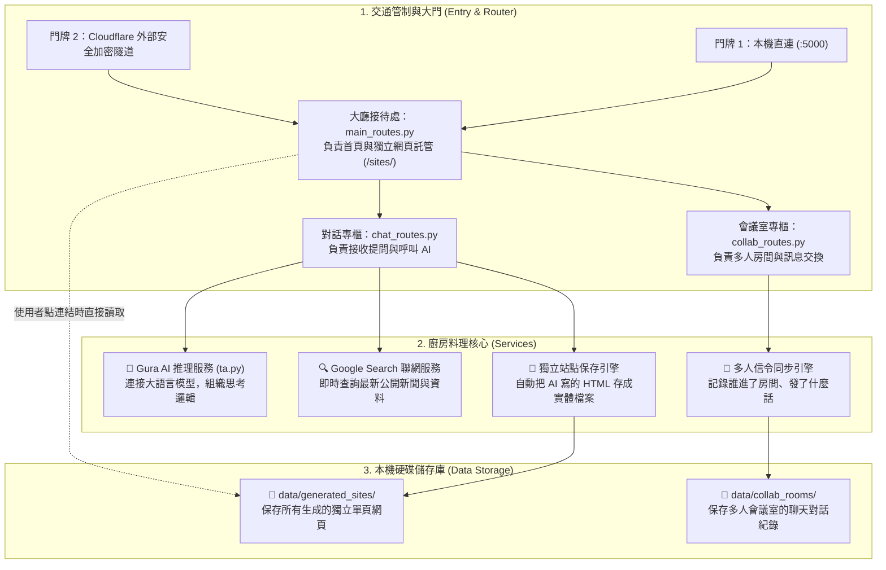
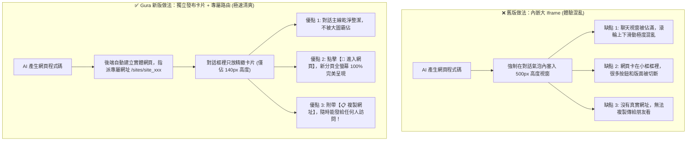

# 🦈 Gura 前端與後端工程架構圖（淺顯易懂圖解版）

> **系統定位**：基於大型語言模型之全方位智慧對話與協作工作平台（Gura AI Platform）  
> **核心特色**：模組解耦、雙向語音、即時聯網、提問日曆、獨立網頁發布卡片、多人連機協作

---

## 🌟 零基礎一眼看懂：Gura 就像一家「未來智慧概念餐廳」！

如果把 Gura 整套系統比喻成一家精緻現代的智慧餐廳：

```
┌────────────────────────────────────────────────────────────────────────┐
│                        💻 前端（Frontend）＝「前台服務生」             │
│  · 負責門面裝潢（自適應卡片版面、好看的聊天泡泡）                      │
│  · 聽取客人需求（文字輸入、語音輸入麥克風）                            │
│  · 為客人放好聽的放鬆音樂（DJ 音樂頻譜律動）                           │
│  · 幫客人翻看歷史點單紀錄（提問日曆、加大歷史卡片）                    │
│  · 料理完成後，端上精美卡片並附上專屬傳送門（Web Launch 卡片）         │
└───────────────────────────────────┬────────────────────────────────────┘
                                    │ 🌐 HTTP REST API / 1.5s 心跳輪詢
                                    ▼
┌────────────────────────────────────────────────────────────────────────┐
│                        ⚡ 後端（Backend）＝「後廚與調度中心」          │
│  · 廚房總調度（Flask 路由閘道，分發各種訂單）                          │
│  · 特聘頂級智慧主廚（Gura 3.6 Flash / 前瞻推理引擎）                   │
│  · 即時外勤採購員（Google Search 聯網檢索，買最新時效材料）           │
│  · 專屬外燴展示間（生成獨立網頁 /sites/<site_id>，全螢幕獨立運行）    │
│  · 多人對講機廣播（協作房間信令，多人同步看一道菜）                    │
└───────────────────────────────────┬────────────────────────────────────┘
                                    │ ☁️ 安全通道與外部 API
                                    ▼
┌────────────────────────────────────────────────────────────────────────┐
│                        🧠 雲端外部智腦（External APIs）                │
│  · Google Gemini 3.6 大語言模型運算雲                                  │
│  · Google 權威搜尋引擎即時資訊庫                                      │
│  · Cloudflare 安全公網穿透隧道                                         │
└────────────────────────────────────────────────────────────────────────┘
```

---

## 🗺️ 一、全端整體運作流程圖（使用者互動流向）

這張圖展示當您輸入一句話（例如：「幫我做一個計時器網頁」）時，資料是如何在前後端之間流動的：



---

## 🎨 二、前端工程架構圖（淺顯易懂版）

前端的核心任務是**「好看、好用、不卡頓」**。整體分為四大清楚工作區塊：



### 💡 前端 4 大模組在做什麼？（白話速查表）

| 模組名稱 | 負責檔案 | 一句話大白話解釋 |
| :--- | :--- | :--- |
| **會話與歷史大卡片** | `app.js` + `style.css` | 把以前的對話整理成一張張精緻舒適的「大卡片」，顯示日期、對話則數，搜尋時還會發光高亮！ |
| **提問日曆系統** | `app.js` (`QuestionCalendar`) | 像手帳一樣，翻開日曆就能看到哪天問過什麼問題，點一下瞬間回到那天！ |
| **網頁發布卡片** | `app.js` (`attachWebLaunchCard`) | 不把巨大的網頁硬塞在聊天框裡，而是給一張「專屬發布卡片」，附上獨立網址，按一下全螢幕開啟！ |
| **雙向語音與 DJ** | `app.js` (`VoiceEngine`) | 按麥克風可以用講的，AI 回覆會唸給你聽，旁邊還有隨節奏跳動的彩色音樂頻譜！ |

---

## ⚡ 三、後端工程架構圖（淺顯易懂版）

後端的核心任務是**「快、穩、安全」**。整體分為三大核心流程：



### 💡 後端 4 大模組在做什麼？（白話速查表）

| 模組名稱 | 負責檔案 | 一句話大白話解釋 |
| :--- | :--- | :--- |
| **首頁與獨立站點路由** | `main_routes.py` | 負責端出前端畫面；當使用者點擊 `/sites/site_xxx` 時，在 4 毫秒內把完整網頁獨立送達瀏覽器！ |
| **對話與聯網核心** | `chat_routes.py` + `ta.py` | 接收提問、判斷要不要上網查 Google、呼叫 Gura 3.6 智腦推理，若發現有網頁就自動存檔！ |
| **多人協作廣播引擎** | `collab_routes.py` | 當多個人在同個專案房間時，負責每 1.5 秒分發最新訊息，讓大家看到的內容完全同步！ |
| **靜態站點資料夾** | `data/generated_sites/` | 一個專屬倉庫，整整齊齊保管每一位使用者做出來的網頁作品，永久留存不遺失！ |

---

## 🚀 四、最新架構亮點：為什麼「獨立發布卡片」比「內嵌在對話框裡」好 100 倍？

使用者先前曾指出：「*我要的是從一條連結進入網頁，而不是讓網頁直接在對話框裡！*」  
下圖展示了這項架構更新帶來的巨大差異：



---

## 📊 五、前後端職責分工總覽表（大白話版）

| 比較項目 | 前端（Frontend） | 後端（Backend） |
| :--- | :--- | :--- |
| **主要居住地** | 使用者的瀏覽器（Chrome, Edge, Safari） | 伺服器主機（Python 環境） |
| **主要程式語言** | 原生 JavaScript (`app.js`) + CSS3 | Python 3.14 (`Flask`, `routes/`, `ta.py`) |
| **最核心的任務** | 讓畫面漂亮、操作順手、語音說讀流暢、日曆排版清楚 | 調用最強 AI 思考、去網路抓最新事實、保管站點檔案 |
| **記憶儲存方式** | 瀏覽器快取（LocalStorage，離線也能翻紀錄） | 實體硬碟資料夾（`data/generated_sites/`） |
| **遇到網頁生成時** | 秀出「發布卡片」，讓使用者一鍵新分頁全螢幕開啟 | 提取完整 HTML，指派專屬網址 `/sites/site_xxx` |
| **遇到語音輸入時** | 調用麥克風即時轉成中文句子填入輸入框 | 專心處理文字語義，回傳高精準度內容 |
| **遇到歷史檢索時** | 畫出 42 格提問月曆，高亮顯示關鍵字 | 支援高併發存取，確保穩定低延遲 |

---
*本工程架構圖已同步更新至 Gura 核心技術文件庫。*
